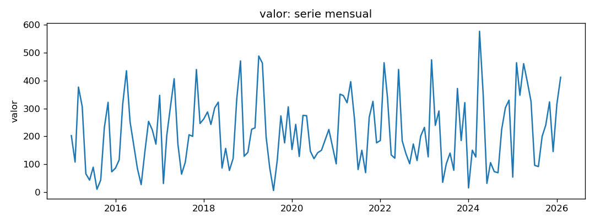
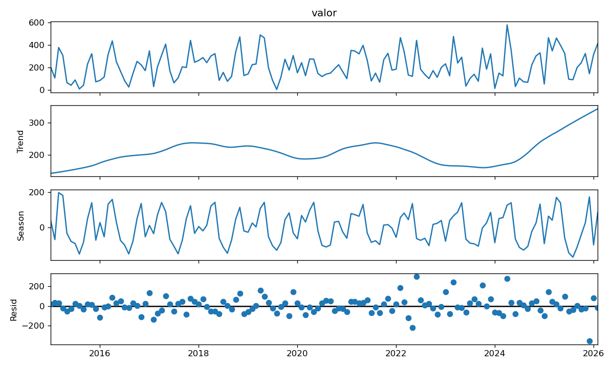
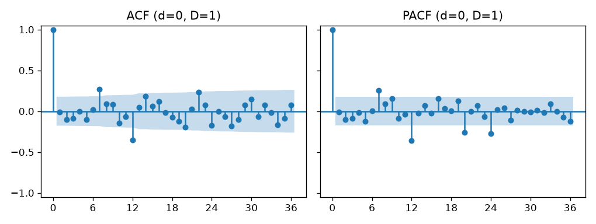
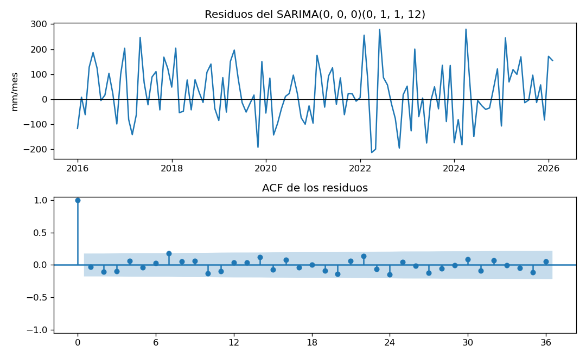

# Informe del miniproyecto 1

Llene cada sección reemplazando los marcadores `{{...}}`, sin quitar las
secciones. Las cifras salen de lo que imprime `python miniproyecto.py` y las
figuras son las que ese guion deja en `figuras/`. Las fórmulas van en LaTeX
(`$...$` o `$$...$$`).

## 1. La serie

La serie es la **precipitación mensual acumulada (mm)** de la estación
**CDEA El Topacio** (código 2629020601), en la cuenca del río Pance (Cali,
Valle del Cauca). Proviene de la red hidrometeorológica de la **Corporación
Autónoma Regional del Valle del Cauca (CVC)**, que suministró por correo
electrónico, para uso académico, los archivos `EXPORT_CPANCE_PRECIP_*.xls`;
se cita a la CVC como fuente.

Los archivos traen dos tipos de registro: la **telemetría automática**, un
dato cada 10 minutos (144 por día), y, en algunos días, un **total diario**
anotado a las 07:00 (el día pluviométrico de 7 a. m. a 7 a. m.). La serie
mensual se construyó con el script `preparar_serie.py`: une las hojas de los
archivos, quita los registros duplicados y suma todos los registros de cada
mes calendario, $y_t = \sum_{i \in \text{mes } t} p_i$, con $p_i$ la lluvia de
cada registro. Un mes con menos del 80 % de días con algún dato se deja vacío.
La serie resultante es **mensual**, va de **enero de 2015 a febrero de 2026** y
tiene **134 observaciones**, más del doble del mínimo de 60 que necesita el
*backtest* (24 meses de prueba y al menos 36 para el primer ajuste).

El grupo la eligió porque es insumo de un trabajo de tesis y porque tiene una
estacionalidad marcada: el régimen de lluvias de la zona andina colombiana es
**bimodal**, con temporadas húmedas en marzo–mayo y octubre–noviembre y una
temporada seca en julio–agosto, lo que la hace adecuada para trabajar la
diferencia estacional y el SARIMA.

**Huecos.** Como en el curso (sesión 1, §7; sesión 2, §14), primero se
comprueba si faltan meses, porque con huecos la STL devuelve vacíos sin avisar
y las métricas se promedian sobre menos meses. La regla del 80 % nunca se
activó: el mes con menos cobertura (mayo de 2017) tuvo datos en el 90 % de
sus días. La función `preparar` reconstruye además el índice mensual
completo: los 134 meses están presentes, sin fechas repetidas, sin valores
negativos ni códigos de faltante (como $-999$) y sin meses en 0 mm (el mínimo
es 5.7 mm, en agosto de 2019). No hubo nada que imputar; si hubiera huecos,
la opción del curso sería la interpolación lineal.

Al revisar los registros crudos apareció un problema que la cobertura no
detecta: en algunos días la telemetría transmite **solo ceros** (143 registros
en 0 mm) y la lluvia del día aparece como un **total diario a las 07:00**, con
valores de 30 a 131 mm, imposibles en 10 minutos. Todo indica que el sensor
automático falló y la lluvia se registró por otra vía. Estos meses tienen la
mayor parte de su lluvia en totales diarios:

| Mes | Total (mm) | Parte en totales diarios |
|---|---|---|
| 2015-05 | 66.0 | 84 % |
| 2015-06 | 43.0 | 98 % |
| 2019-04 | 488.1 | 71 % |
| 2020-11 | 224.6 | 67 % |
| 2022-01 a 2022-03 | 185.0 / 464.1 / 340.0 | más del 90 % |
| 2022-06 | 440.0 | casi todo (69 registros en el mes) |
| 2023-05 | 291.0 | todo (un registro por día) |
| 2025-12 | 145.4 | 64 % |

La serie combina entonces dos formas de medir. En unos pocos días hay
lluvia en los dos tipos de registro (por ejemplo, octubre de 2019), lo que
sugiere un posible doble conteo pequeño.

**Atípicos.** Un criterio sobre la serie completa no sirve para una serie
estacional: 400 mm es normal en abril y extraordinario en agosto. Por eso los
atípicos se buscan en el residuo de la STL robusta,
$R_t = y_t - T_t - S_t$, que compara cada mes con lo esperado para ese mes. Se
marca como atípico el mes cuyo residuo cae fuera de
$[Q_1 - 1.5\,\mathrm{IQR},\ Q_3 + 1.5\,\mathrm{IQR}]$ de los residuos, es decir,
fuera de $[-174.5,\ 172.7]$ mm. Salen 7 meses:

| Mes | Observado (mm) | Esperado $T_t + S_t$ (mm) | Residuo (mm) | Peso STL |
|---|---|---|---|---|
| 2025-12 | 145.4 | 502.3 | −356.9 | 0.00 |
| 2022-06 | 440.0 | 139.2 | +300.8 | 0.00 |
| 2024-04 | 577.0 | 299.1 | +277.9 | 0.00 |
| 2023-03 | 474.6 | 232.2 | +242.4 | 0.01 |
| 2022-05 | 121.6 | 344.4 | −222.8 | 0.07 |
| 2023-10 | 371.8 | 157.4 | +214.4 | 0.10 |
| 2022-02 | 464.1 | 278.4 | +185.7 | 0.23 |

La STL robusta les da un peso casi nulo, de modo que no deforman la tendencia
ni la estacional y quedan en el residuo. Su lectura, contrastada con los
registros crudos:

- **Diciembre de 2025** (−356.9 mm) es en buena parte un **efecto de borde**:
  está al final de la serie, donde la tendencia LOESS solo tiene vecinos de un
  lado y sube a unos 340 mm/mes, así que el valor esperado (502 mm) está
  inflado. Además, el 64 % de su lluvia viene de totales diarios.
- **Junio de 2022** (+300.8 mm) y **febrero de 2022** (+185.7 mm) se midieron
  casi por completo con totales diarios. Junio cae en una temporada que
  debería ser seca y durante el episodio de La Niña 2020–2023, que aumenta la
  lluvia en la región andina; pero el cambio en la forma de medir también
  puede explicar el salto. Son **posibles atípicos de medición**.
- **Mayo de 2022** (−222.8 mm) es telemetría con el 97 % de los registros en
  cero, justo entre dos meses medidos con totales diarios: puede ser un mes
  seco o un sensor que falló sin respaldo diario.
- **Abril de 2024** (577 mm, el máximo), **marzo de 2023** y **octubre de
  2023** se midieron con telemetría y caen en temporadas húmedas: son meses
  lluviosos reales, más intensos que lo habitual.

**Decisión.** Los atípicos se **conservan**. Ninguno muestra un valor imposible
(negativo o código de faltante). Los medidos con telemetría son lluvia real, y
quitarlos haría que los modelos subestimaran los meses muy lluviosos, que son
justamente los que interesa pronosticar. Los medidos con totales diarios
quedan señalados como posibles artefactos de medición: corregirlos exigiría
reconstruir la serie desde los registros crudos con una regla por día (usar
el total diario cuando exista y, si no, la suma de la telemetría), lo que se
deja para el miniproyecto 2. La serie no se modifica, así que esta decisión no
introduce información del futuro en el *backtest*.

Decisión (columna `decision` de la tabla): *sin huecos (regla del 80 % no
activada); atípicos del residuo STL conservados; meses con totales diarios
señalados como posible artefacto*.

## 2. Componentes

La STL separa la serie en tres partes, $y_t = T_t + S_t + R_t$: la tendencia,
la estacionalidad y el residuo. La versión robusta evita que los meses
atípicos distorsionen las dos primeras.

**Tendencia.** No sube ni baja de forma sostenida: oscila entre unos 155 y
231 mm/mes entre 2015 y 2024, con años más lluviosos (2018, 2021) y más secos
(2015, 2023) que coinciden con La Niña y El Niño. El salto final (289 mm/mes
en 2025 y 339 en 2026) se debe en parte a que 2025 fue muy lluvioso y en
parte a que la tendencia es menos confiable en el extremo de la serie.

**Estacionalidad.** El año tiene **dos temporadas de lluvia y dos secas**,
como es típico en la zona andina colombiana:

| Ene | Feb | Mar | Abr | May | Jun | Jul | Ago | Sep | Oct | Nov | Dic |
|---|---|---|---|---|---|---|---|---|---|---|---|
| −40.6 | +24.1 | +69.3 | **+118.6** | +109.4 | −59.0 | −102.7 | **−125.1** | −93.4 | +20.8 | +68.1 | +17.3 |

El mes más lluvioso es **abril (+118.6 mm** sobre la tendencia) y el más seco
es **agosto (−125.1 mm)**; octubre y noviembre forman la segunda temporada de
lluvias. Entre abril y agosto hay unos 244 mm de diferencia.

**Residuo.** Es grande: casi tan importante como la estacionalidad, lo que
indica que buena parte de la lluvia de cada mes no sigue un patrón regular.
Por eso cabe esperar errores de pronóstico altos con cualquier modelo. El
residuo más grande es **diciembre de 2025 (−356.9 mm)**, explicado en la
sección 1.

## 3. Líneas base y backtest

{{Cómo es el backtest: cuántos orígenes, horizonte y qué meses quedan en la
prueba. Por qué ningún dato posterior al origen entra al modelo.}}

{{RMSE, MAE y MAPE del ingenuo y del estacional ingenuo, y cuál gana.}}

## 4. Estacionariedad e identificación

Un SARIMA necesita una serie **estacionaria**, que oscile alrededor de un
nivel fijo. Para lograrlo se puede diferenciar: restar el mes anterior
($d = 1$) quita una tendencia, y restar el mismo mes del año anterior
($D = 1$) quita el ciclo anual. La prueba ADF decide si hace falta: su
hipótesis nula es que la serie **no** es estacionaria, y un valor p menor
que 0.05 la rechaza. En la serie original se usa `regression='ct'` (constante
y tendencia), para no confundir una posible recta con falta de
estacionariedad; en las diferenciadas, `'c'`, porque ya no tienen tendencia.

| Versión | $d$ | $D$ | `regression` | Valor p |
|---|---|---|---|---|
| Original | 0 | 0 | `ct` | 0.2092 |
| Original | 0 | 0 | `c` | 0.0992 |
| `diff()` | 1 | 0 | `c` | $3.1 \times 10^{-11}$ |
| `diff(12)` | 0 | 1 | `c` | **0.0033** |
| `diff(12).diff()` | 1 | 1 | `c` | 0.0017 |

La original no pasa la prueba. La regla del curso es elegir la combinación
con **menos diferencias** que pase, y aquí hay un empate: `diff()` y
`diff(12)` pasan las dos con una sola diferencia. Se elige
**$d = 0$, $D = 1$** por tres razones:

- La serie no tiene tendencia sino un ciclo anual (sección 2), así que la
  diferencia que corresponde es la estacional.
- Con `diff()` el ciclo anual no desaparece: su ACF todavía tiene una barra
  positiva en el rezago 12 (+0.22). Además, la barra negativa en el rezago 1
  (−0.29) y la PACF negativa en los rezagos 1 a 5 son la señal de
  **diferenciar de más**. La ADF no detecta este problema, porque no está
  pensada para el ciclo estacional.
- Es la misma elección del taller 1.

Con la serie elegida, $w_t = y_t - y_{t-12}$ (122 datos, banda de
$\pm 1.96/\sqrt{122} \approx \pm 0.177$):

- **ACF fuera de la banda:** rezagos 7 (+0.27) y 12 (−0.35).
- **PACF fuera de la banda:** rezagos 7 (+0.25), 12 (−0.36), 20 (−0.26) y
  24 (−0.28).

La ACF **se corta** en el rezago 12 y la PACF **baja poco a poco** en 12 y
24: es la firma de un término **MA estacional** ($Q = 1$). En los rezagos
cortos no queda casi nada, lo que sugiere $p = q = 0$. El punto de partida
para la sección 5 es entonces un **SARIMA$(0,0,0)(0,1,1)_{12}$**. La barra en
el rezago 7 probablemente es azar: con 36 rezagos y bandas al 95 % se esperan
unas $36 \times 0.05 \approx 1.8$ barras fuera por casualidad, y no hay un
motivo físico para una relación de 7 meses.

## 5. Modelos clásicos

{{La rejilla de órdenes y su AIC. El modelo elegido, escrito con su
ecuación.}}

{{Diagnóstico de los residuos: Ljung-Box y lo que muestran la gráfica y su
ACF.}}

{{La variable exógena: qué es, por qué se conoce de antemano y si mejora al
SARIMA.}}

## 6. Tabla de métricas

{{Copie aquí `resultados/metricas.csv` como tabla de Markdown, ordenada por
RMSE.}}

| Modelo | Decisión | RMSE | MAE | MAPE (%) |
|---|---|---|---|---|
| {{...}} | {{...}} | {{...}} | {{...}} | {{...}} |

## 7. Conclusión

{{El mejor modelo clásico, cuánto mejora a la mejor línea base en cada
métrica y en qué meses o tramos sigue fallando. Es el modelo que el
miniproyecto 2 debe superar.}}
